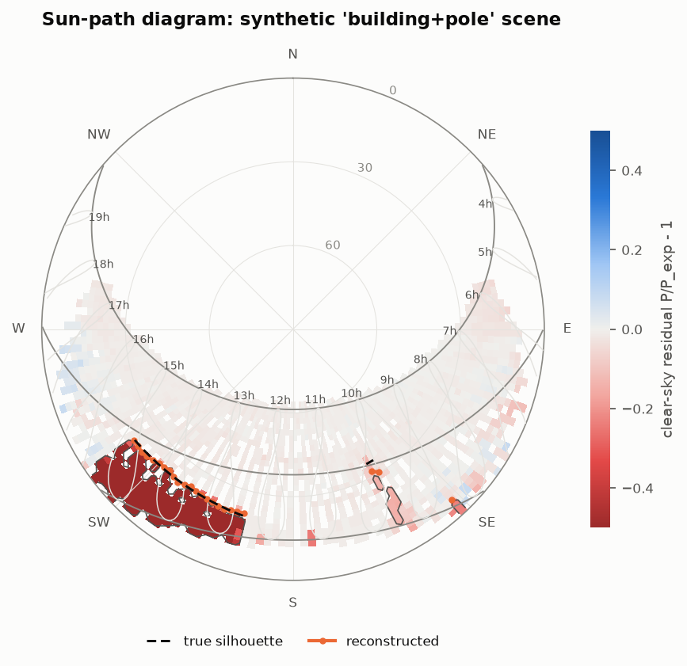
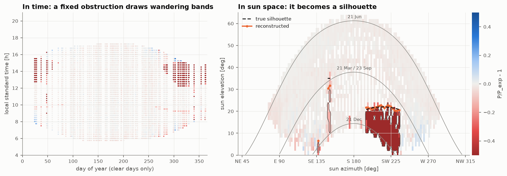
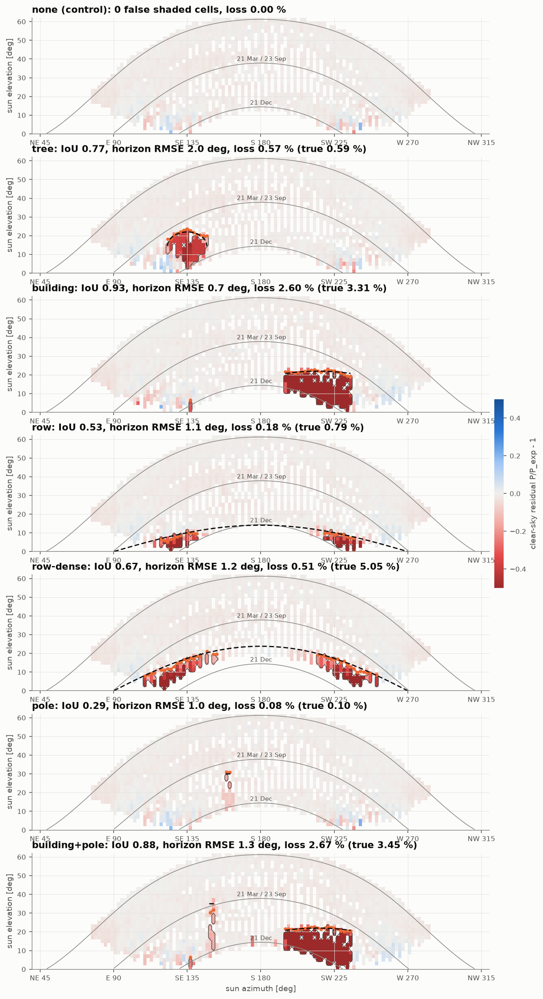
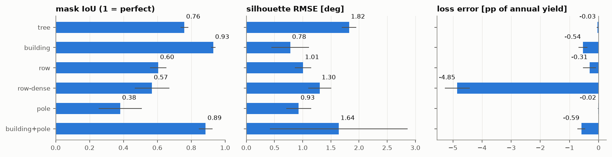
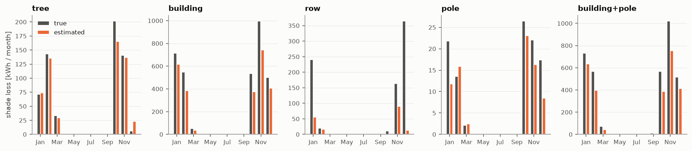
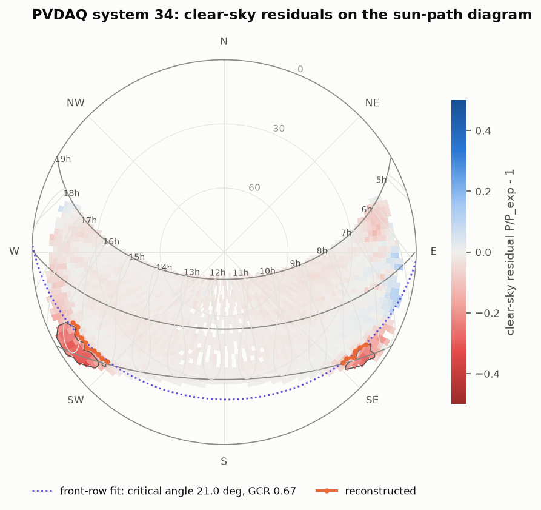
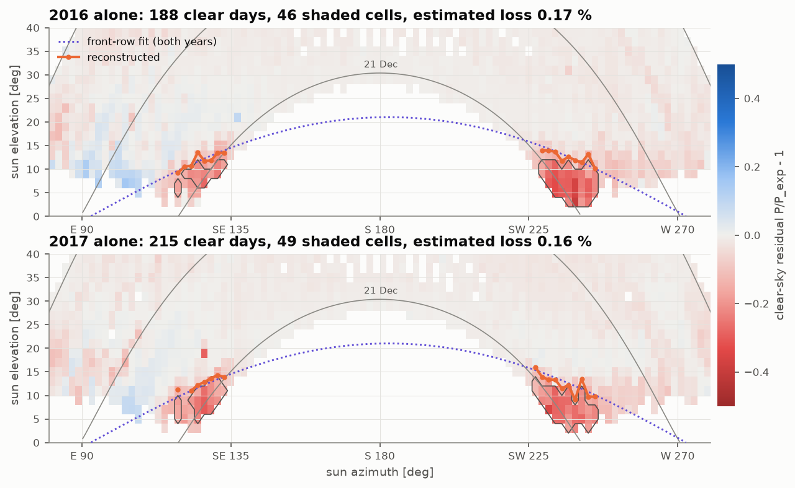
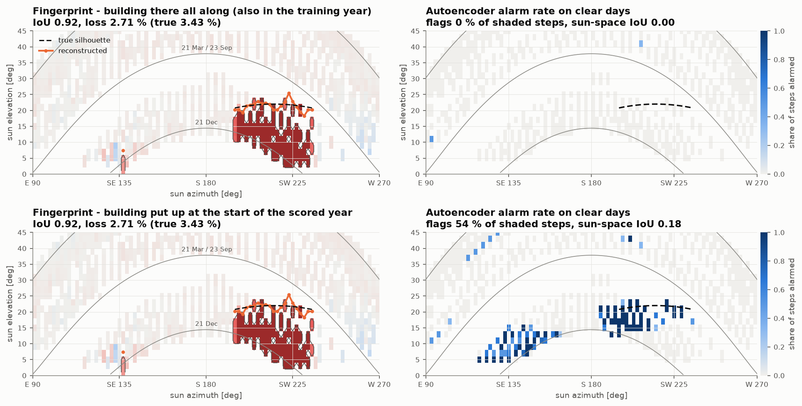

# Shade fingerprint: finding, drawing and costing PV shading from power data alone


A PV system loses power on clear winter afternoons. Is it a tree, a neighbour's building, the row in front? How tall
is it, and how much energy does it cost per year? This project answers those questions from the system's **AC power
alone**: no irradiance sensor, no site visit, no drone. The method, **sun-path residual fingerprinting**, is fully
explainable: every number it reports can be traced to a cell on a sun-path diagram and to the days on which the sun
stood there.

It is validated on simulated systems with known obstructions (a tree, a building, the row in front, a lamp post)
buried in realistic noise, clouds, outages, derating, snow and soiling, then run on two years of a real rooftop
system from NREL's PVDAQ, and compared with the anomaly-detecting autoencoder of
[pv-anomaly-autoencoder](https://github.com/kwwaleszczynski-del/pv-anomaly-autoencoder).



*A synthetic building (south-west) and a lamp post (south-east) on the sun-path diagram. Background: how far the
clear-sky power fell short of the expected power whenever the sun stood in that cell (red = shortfall). Dashed: the
true silhouette, orange: the one reconstructed from 15-minute power data.*

## Key results

| Scenario | Mask IoU | Silhouette RMSE [deg] | Columns found [%] | True loss [%] | Estimated loss [%] | Error [pp] |
|---|---|---|---|---|---|---|
| tree | 0.76 ± 0.02 | 1.8 ± 0.1 | 100 ± 0 | 0.64 ± 0.08 | 0.60 ± 0.11 | -0.03 ± 0.04 |
| building | 0.93 ± 0.01 | 0.8 ± 0.3 | 100 ± 0 | 3.49 ± 0.29 | 2.95 ± 0.43 | -0.54 ± 0.15 |
| row | 0.61 ± 0.05 | 1.0 ± 0.1 | 70 ± 11 | 0.78 ± 0.05 | 0.47 ± 0.24 | -0.31 ± 0.22 |
| row-dense | 0.57 ± 0.10 | 1.3 ± 0.2 | 52 ± 9 | 5.15 ± 0.39 | 0.30 ± 0.21 | -4.85 ± 0.43 |
| pole | 0.38 ± 0.13 | 0.9 ± 0.2 | 100 ± 0 | 0.12 ± 0.02 | 0.10 ± 0.02 | -0.02 ± 0.01 |
| building+pole | 0.89 ± 0.04 | 1.6 ± 1.2 | 99 ± 2 | 3.63 ± 0.30 | 3.04 ± 0.41 | -0.59 ± 0.14 |

Simulated 100 kWp roof at 52° N, two years of 15-minute data each, seeds 1-5 (mean ± standard deviation).

- **No false alarms without an obstruction.** In the control scene the method marks 1.2 cells per run on average
  (at most 3, isolated, at the lowest sun) and estimates a loss of at most 0.001 %.
- **Silhouettes within about 1-2°**: 0.8° for the building, 0.9° for a 3° lamp post, 1.0° for the row in front,
  1.8° for a semi-transparent tree crown, from 15-minute data in which the sun moves 3-4° per step.
- **Annual loss**: within 0.03 percentage points for the tree and the pole. The building's 3.5 % is underestimated
  by 0.5 pp (16 %). For the row in front the estimate is a lower bound (see Limitations).
- **The layout of the rows comes back from power data alone**: ground coverage ratio 0.335 ± 0.007 (true 0.35)
  for the typical layout, 0.48 (true 0.50) for the dense one.
- **The data's clock is found**: for 15-minute means labelled at the start of the interval, the method puts the
  sun 7.5 ± 0.7 min after the timestamp (true: 7.5).
- **Real rooftop (NREL PVDAQ 34, Las Vegas)**: shading from the row in front on winter mornings and afternoons,
  ground coverage ratio about 0.67. The same silhouette comes out of 2016 and 2017 separately, and the plant's own
  pyranometer, which the method never sees, confirms that the array is shaded and the sensor is not. It costs
  about 0.16 % of the annual yield.
- **Versus the autoencoder**: when the obstruction has always been there, the autoencoder flags 0 % of the shaded
  steps, because it learned the shade as normal. The fingerprint finds it either way (mask IoU 0.92). The
  autoencoder remains the right tool for what the fingerprint ignores on purpose: it caught 6-7 of 7 outages,
  derates and snow events within the scored year.

## Method: sun-path residual fingerprinting

**Idea.** A tree, a building or the row in front blocks the sun at the same place in the sky every time, whatever
the date or the hour. Clouds, outages, soiling and snow do not care where the sun is. So the shortfall of every
clear-sky measurement is plotted not against time but against the sun's position. In time, a fixed obstruction draws
bands that wander with the seasons; in sun space it becomes a silhouette, while everything else spreads out:



The only input is AC power with timestamps, plus the system's location, orientation and nameplate. Four steps:

**1. Expected clear-sky power.** Ineichen clear sky with the Linke turbidity climatology, Perez transposition and an
ASHRAE incidence-angle loss give the effective irradiance in the module plane, split into beam $`B`$ and diffuse $`D`$:

```math
E(t) = B_{cs}(t)\,\mathrm{IAM}(\theta) + D_{cs}(t)
```

An efficiency curve with six coefficients turns it into power, and one scale per day absorbs whatever moves a whole
day up or down (soiling, turbidity, slow degradation):

```math
P_{cs}(t) = E\left(c_0 + c_1\frac{E}{1000} + c_2\ln\frac{E}{1000} + c_3\,\tau(t) + c_4\frac{D_{cs}}{E} + c_5\frac{B_{cs}(1/\cos\theta - 1)}{E}\right), \qquad P_{exp}(t) = s_d\,P_{cs}(t)
```

$`c_1, c_2`$ cover part-load and low-light behaviour and module heating, $`\tau(t) = \cos(2\pi(h_{solar} - 15)/24)`$ the
afternoon peak of the air temperature, $`c_4`$ and $`c_5`$ errors of the diffuse model and of the incidence-angle loss.
None of them can follow a feature that sits at one azimuth. The coefficients are fitted by **Huber regression**
(iteratively reweighted least squares, scale from the MAD) on clear days only, and only outside the current shade
estimate. The day scale is the upper quartile of $`P / P_{cs}`$ over the day's steps with the sun above 10°, so a
shadow over part of the day does not pull it down.

**Clear days from production alone.** A day is clear when its clearness index (the day scale relative to the
90th percentile of its ±15-day neighbourhood, which makes it insensitive to soiling) is at least 0.9, its
normalised power is smooth (median step-to-step change ≤ 0.03), it has no flat top below the inverter rating (a
derated inverter) and no step without output while the sun is up (snow cover, outage; an obstruction never takes
the diffuse light, so shade alone never produces zeros).

**Clock offset.** Most SCADA exports label 15-minute means with the start of the interval, some with the end, some
drift. The sun position is evaluated at timestamp + δ, and δ is the shift (grid of 2.5 min, parabolic refinement)
that minimises the median absolute clear-day residual: the one that makes mornings and evenings agree.

**2. Residuals in sun space.** On clear days, for every step with the sun above 3° and less than 80° off the module
normal (no beam to shade otherwise) and below the inverter limit,

```math
r(t) = \frac{P(t)}{P_{exp}(t)} - 1
```

is binned on a 2° × 2° grid of solar azimuth and elevation. Each cell keeps the number of distinct days, the median
and the **upper quartile $`q_{75}`$** of its residuals, pooled with the cells directly above and below (elevation only,
so azimuth keeps its full resolution). A cloud that slipped through the clear-day filter pulls single samples down;
$`q_{75}`$ ignores it unless it happens on more than a quarter of the visits.

**3. Shade mask.** A cell is shaded when even its better visits fall short, $`q_{75} < -0.10`$, and it was seen on at
least 3 clear days; patches smaller than 3 cells are dropped. Steps 1-4 are iterated three times: the mask and
everything below the silhouette are left out of the next calibration and day scales, so the shade does not bend
the expected-power model.

**4. Silhouette and loss.** For each 2° azimuth column, the obstruction's height $`h`$ is a **decision stump** on the
column's samples (elevation $`e_i`$, residual $`r_i`$): with $`s_i = [r_i < -0.05]`$,

```math
h = \arg\min_h \;\#\{i: e_i < h,\ \neg s_i\} + \#\{i: e_i \ge h,\ s_i\}
```

searched between the mask's upper edge and the first cell above it that was seen clear. Above the mask, a shaded
sample counts only if a shaded sample of another day lies within one cell of it: the persistence the mask asks for,
so that one bad day cannot lift the edge where the sampling leaves no other evidence. The edge lies somewhere
between the last shaded and the first unshaded sample; where 15-minute sampling leaves a wide gap there, the
neighbouring columns' median height is used, kept inside the gap. A column is **censored** when no unshaded sample
lies above $`h`$: the obstruction may be taller than anything the sun showed.

The energy lost to shade is estimated for every step that falls in the mask, cloudy steps included:

```math
L(t) = b(t)\left[\min(P_{ref}, P_{AC,0}) - \min\big(P_{ref}(1-\delta_{cell}), P_{AC,0}\big)\right], \qquad P_{ref} = \bar s\,P_{cs}(t)
```

$`\delta_{cell} = -\mathrm{median}(r)`$ is the cell's clear-sky depth, $`\bar s`$ the rolling median of clear-day scales
(the plant's state of soiling), and the inverter limit $`P_{AC,0}`$ matters: shade on an oversized array costs nothing
while the inverter clips. $`b(t)`$ is the share of the clear-sky beam that was there, because an obstruction only takes
the beam. It is read from the step's unshaded neighbours on the same day (centred window of 9 steps): with
$`k = P/P_{ref}`$, a two-state sky gives $`b = \mathrm{clip}\big((k - 0.3)/(1 - 0.3), 0, 1\big)`$, the share of time the
sun was out.

**Row geometry.** When the silhouette is the row in front, it follows
$`\tan h = \tan\alpha_c\cos(\varphi - \varphi_0)`$, linear in $`(\tan\alpha_c\cos\varphi_0, \tan\alpha_c\sin\varphi_0)`$.
The fitted critical profile angle $`\alpha_c`$ and the module tilt $`\beta`$ give the ground coverage ratio
$`GCR = \tan\alpha_c / (\sin\beta + \tan\alpha_c\cos\beta)`$.

## Validation design: a simulated system with known obstructions

Shading on a real plant is rarely documented in detail, so the method is scored on simulated data where every
obstruction is known exactly. Nothing is downloaded; a two-year simulation takes about 5 seconds.

**System.** 100 kWp on a flat roof at 52.2° N (central Europe), 30° tilt facing south, 85 kW inverter
(DC/AC 1.18). Two years of 5-minute physics, reported as 15-minute means **labelled at the start of the interval**,
like most SCADA exports (the method has to find the 7.5-minute offset itself).

**Physics the method does not get.** Day-to-day turbidity, Perez transposition with a different coefficient set,
physical (Fresnel) incidence-angle losses, SAPM module temperature driven by synthetic weather, the ADR efficiency
model (low light, temperature), a hidden 3 % DC loss and a PVWatts inverter with clipping. The sky follows a Markov
chain of daily regimes (clear, broken clouds, overcast) with seasonal probabilities; on broken days the sun switches
between out and behind a cloud every few minutes. About a quarter of the days are clear.

**Disturbances that must not look like shade**, a few of each per year: inverter outages (whole days and a few
hours), derating (output capped at 55-80 % for 3-10 days), snow cover that slides off later in the day, soiling
that builds up between rains (up to 12 %), data gaps of days, single missing steps, and 1 % measurement noise.

**Obstructions.** Each is a silhouette on the sky plus the share of beam power it removes, with an electrical
mismatch factor (a shadow over a few cells bypasses a whole substring):

| Scenario | Obstruction | Where | Beam loss behind it |
|---|---|---|---|
| none | - | - | control: no shade at all |
| tree | elliptical crown on a trunk, 40 % transparent | SE, 123-147°, up to 22° | 47 % (crown), 78 % (trunk) |
| building | wall, flat roof edge | SW, 195-235°, up to 22° | 100 % |
| row | the row in front, GCR 0.35 | south, up to 14.1° (critical angle) | grows from 0 to 90 % as the sun drops |
| row-dense | the row in front, GCR 0.5 | south, up to 23.8° | same, much larger |
| pole | lamp post, 3° wide | 158.5-161.5°, up to 30° | 24 % |
| building+pole | both, the pole at 150°, 35° tall | | |

**Metrics**, all on the 2° grid restricted to cells seen on at least 3 clear days:

- **mask IoU**: estimated shade mask vs. cells where the true obstruction removes at least 10 % of the beam;
- **silhouette RMSE**: reconstructed vs. true obstruction height over the azimuth columns where the true edge lies
  inside the elevation range the sun showed (where it can be identified at all); censored columns are left out;
- **coverage**: share of those columns that got a height;
- **loss error**: estimated minus true annual energy lost to shade, in percentage points of the unshaded yield;
- **false cells** in the obstruction-free control.

Design choices (grid, quantile, depth threshold, clear-day thresholds, the loss estimator) were made on development
seeds 101 and 102. The numbers above come from seeds 1-5.

**Two fixes after the first test run.** The design was frozen on the development seeds before seeds 1-5 were run
once. The charts of that first run showed two robustness bugs, both on the building: the derate filter missed flat
tops under 1 % measurement noise (it asked for 5 steps within 1 % of the day's maximum), and the silhouette stump
let one such day lift the edge by up to 7° where 15-minute sampling left no other samples. Both were fixed (3 %
tolerance; a shaded sample above the mask needs a second day nearby), checked on the development seeds, and seeds
1-5 run again. The table above is the second run; the first is kept in `results/validation_first_run.csv`.
The fixes moved the building's silhouette RMSE from 1.5 ± 1.0° to 0.8 ± 0.3° (building and pole: 2.1° to 1.6°)
and changed no other metric by more than 0.01 in IoU or 0.03 pp in loss; the derate filter now drops about 3 more
days per two years.

## Results on the simulated system

Every scenario on seed 1, in sun space. The thin outline is the shade mask, dashed the true silhouette, orange the
reconstruction (open triangles would mark censored columns):





- **Tree.** The crown's outline is found within about 2°, and the loss almost exactly, although the crown lets 40 %
  of the light through and its flanks leave sky below them. The "false" cells are mostly the crown's fringe, where the
  true loss is just under the 10 % that defines the true mask.
- **Building.** The wall's edge is the easiest case: opaque, wide, with a sharp top. The loss is underestimated by
  about 16 %: the building shades winter afternoons, when clear days are rare (February had 7 in two years on
  one development seed), so its lowest and rarest cells are only partly covered.
- **Pole.** A 3° post seen through 15-minute means: the sun crosses it in less than one step, so each sample holds a
  diluted shadow and only part of it passes the 10 % threshold (IoU 0.38). Its height, which is what an
  engineer would want to know, is found within 0.9°.
- **The row in front.** The edge is found within about 1° wherever the sun showed it, and fitting the row geometry to
  the silhouette gives the layout back: critical profile angle 13.3 ± 0.3° (true 14.1°), **GCR 0.335 ± 0.007
  (true 0.35)**, row azimuth 179.5 ± 1.3°. The dense layout gives GCR 0.48 ± 0.01 (true 0.50). The loss is the weak
  spot: see the first limitation below.
- **No obstruction.** 1.2 shaded cells per run on average (at most 3, isolated cells at the lowest sun) and an
  estimated loss of at most 0.001 %.
- **Clock offset.** Over all 35 runs the 15-minute labels were found to sit 7.5 ± 0.7 min before the middle of their
  interval (true: 7.5 min).

The monthly loss, estimated against true, shows where the method sees and where it does not (seed 1):



## Real data: NREL PVDAQ system 34

The method on a real roof: [PVDAQ](https://doi.org/10.25984/1846021) system 34, a school building in Las Vegas, NV
(146.6 kWp, 611 mono-Si modules tilted 11.2° to the south on a flat roof, one 135 kW inverter), 15-minute data for
2016-2017. Only the AC power goes in; the published metadata say nothing about shading or the row layout.



**What it finds.** Shade in two patches, symmetric about south: winter mornings in the south-east (azimuth
123-133°) and winter afternoons in the south-west (227-245°), up to 11-15° above the horizon. At noon the winter sun
(30° high in Las Vegas) clears it. Fitted with the row model (purple, dotted), the two patches are one silhouette:
the row in front, facing 183°, with a critical profile angle of 21.0° (RMSE 1.0°). With the published 11.2° tilt
that is a ground coverage ratio of about 0.67, plausible for a densely packed flat roof. The clock offset is
-1.2 min: the timestamps sit close to the middle of their intervals.

**Is it real?** There is no ground truth, so three independent checks:

1. **Year to year.** Each year fingerprinted on its own gives the same shape: mask IoU 0.72 between 2016 and
   2017, silhouette heights 1.5° RMS apart over 16 common columns, estimated loss 0.17 % and 0.16 %.
2. **The pyranometer**, which the method never sees. Inside the mask, power divided by the measured plane-of-array
   irradiance falls 50 % below its midday level, against 10 % elsewhere at low sun, while the sensor itself shows no
   shortfall there (it reads above the clear-sky model, not below). The array is shaded and the sensor is not, so
   the patches are neither a sky effect nor an error of the expected-power model.
3. **Geometry.** The morning and the afternoon patch lie on one row-profile curve within 1°, as rows in front
   would draw them, rather than looking like two unrelated objects.

What it does not flag: a faint band of -5 to -10 % on summer mornings and evenings, when the sun grazes the 11°
modules from the east and the west. It stays under the 10 % threshold and may be an incidence-angle error of the
model as much as a distant horizon.



**What it costs.** About 0.16 % of the annual yield: the shade falls on low winter sun, when there is little
energy to lose. Small, but it is a property of the roof that an expected-yield model for this system should carry,
and the same layout at a higher latitude would lose far more.

## What each model explains: comparison with the autoencoder

The autoencoder of [pv-anomaly-autoencoder](https://github.com/kwwaleszczynski-del/pv-anomaly-autoencoder) learns
how power, irradiance, temperature and sun position normally go together and flags 2-hour windows it cannot
reconstruct. It was run exactly as in its repository (same features, network, smoothing and 99.5 % validation
threshold) on this project's simulated system with the building, trained on a healthy year and scored on the next
year, which carries the usual outages, derating, snow and soiling. Two situations: the building has always been there
(it shades the training year too), or it is put up at the start of the scored year. The fingerprint gets the scored
year's power only. One seed, so the numbers are illustrations, not statistics.

| | Building there all along | Building new in the scored year |
|---|---|---|
| Autoencoder: shaded clear-sky steps flagged | **0 %** | 54 % |
| Autoencoder: share of its alarms in the shade / in events / elsewhere | 8 / 59 / 33 % | 25 / 18 / 57 % |
| Autoencoder: outage, derate and snow events flagged | 6 of 7 | 7 of 7 |
| Autoencoder: sun-space IoU of its alarms (cells alarmed > 50 % of the time) | 0.00 | 0.18 |
| Fingerprint: mask IoU, silhouette RMSE | 0.92, 1.4° | 0.92, 1.4° |
| Fingerprint: annual loss (true 3.43 %) | 2.71 % | 2.71 % |

The fingerprint's two columns are identical: it only sees the scored year, which is the same in both situations.

| Question | Shade fingerprint | Autoencoder |
|---|---|---|
| Is something wrong right now? | no: needs months of clear days | **yes**, within hours |
| Outage, derate, snow? | dropped on purpose by the clear-day filter | **its job** |
| Shade that was always there? | **yes** | no: it is "normal" in the training year |
| Where in the sky, which object, how tall? | **silhouette per 2° of azimuth**, row geometry | no |
| How much energy per year? | **yes** | no |
| Inputs | AC power, nameplate, orientation | power, irradiance, temperatures and a healthy year |



- **An anomaly detector only sees what changed since training.** A building that has always stood there is part
  of normal, however much energy it costs. Shade that belongs to a plant's design or history needs a physical
  reference, not a learned one.
- **When it does see the shade, it does not draw it.** Two thirds of the autoencoder's alarms outside the shade are
  early mornings, 82 % of them after a shaded afternoon. Their raw window score is normal (median -0.08 training
  spreads, against -3.0 in the shade): the alarm comes from the smoothing, which averages the last 8 daylight steps
  across the night. The autoencoder says *when* something was off, the fingerprint *where in the sky, how tall and
  how much*.
- **They are complementary.** The autoencoder belongs in daily operations: an outage flagged in hours, not when the
  inverter gets round to reporting it. The fingerprint belongs in a yearly performance review, a due-diligence
  check of a plant's shading, or in the horizon profile of the expected-yield model.

## Limitations

- **Shade that lasts the whole day is invisible.** The day scale exists to absorb soiling and turbidity, and it
  cannot tell a day that is 30 % short everywhere from a dirty or hazy one. Production data alone cannot either: an
  array whose beam is blocked all day looks like an overcast day. At 52° N a dense row (GCR 0.5) shades every
  December day from sunrise to sunset; the method finds its edge and its geometry in the shoulder months but
  recovers only a few percent of its loss. For the typical layout (GCR 0.35) the loss estimate is a lower bound.
  An irradiance sensor or a trusted absolute model would close the gap; the fitted row geometry is the place to start.
- **The sun has to pass behind the obstruction on clear days.** Below the winter sun path and above the summer path
  nothing can be seen (those columns are reported as censored or not at all); a site with few clear days needs more
  data. One year was enough for the building; two years are used for the validation.
- **15-minute data blur the edges.** The sun moves 3-4° in a quarter of an hour, so a 3° pole is never fully
  resolved; its height is found, its width and depth only partly.
- **Simulated validation.** Obstructions are rigid and the same all year. A deciduous tree, which is transparent in
  winter and opaque in summer, breaks the assumption that both seasonal passes of the sun look the same; snow on the
  modules that slides off at the same hour on many days could imitate shade.
- **One real system without ground truth.** The PVDAQ result is consistent with row shading (year to year, sensor
  check, geometry fit), but the roof layout is not published, so it is a plausible reading, not a verified one.
- **Azimuth does not wrap.** Obstructions north of the array (near 0°/360°) are not merged across the seam; they only
  matter at high latitudes in summer mornings and evenings, when the sun is behind most tilted arrays anyway.

## Run it

```bash
python -m venv .venv && .venv/Scripts/activate        # or source .venv/bin/activate
pip install -e ".[dev]"
pytest -q
python -m pv_shade validate                          # 7 scenarios x seeds 1-5, about 20 minutes
python -m pv_shade real --fetch                      # PVDAQ system 34, downloads 731 daily files (8 MB)
pip install torch "pv-anomaly-autoencoder @ git+https://github.com/kwwaleszczynski-del/pv-anomaly-autoencoder"
python -m pv_shade compare                           # autoencoder comparison, about 3 minutes on a CPU
```

`validate` writes `results/validation.csv` (every scenario and seed), `results/validation_summary.csv`,
`results/row_fit.csv` and the charts in `docs/img/`. `real` writes `results/pvdaq_34/` (summary, silhouette per year,
monthly loss) and its charts; without `--fetch` it reads the daily files from `--pvdaq-dir`. `--help` lists the
options of each command. Simulations are seeded and cached in `data/`.

```
src/pv_shade/
  site.py          system definition, sun position, clear-sky irradiance in the module plane
  obstructions.py  tree, building, row, pole: silhouettes and beam loss; validation scenarios
  simulate.py      synthetic system: weather, physics, obstructions, disturbances
  model.py         step 1: expected clear-sky power, Huber calibration, clear days from production
  fingerprint.py   steps 2-4: sun-space residuals, shade mask, silhouette, loss; clock offset; row fit
  metrics.py       IoU, silhouette RMSE, loss error against the known scene
  validate.py      scenario x seed runs with caching
  compare.py       the pv-anomaly-autoencoder model on the same data
  pvdaq.py         NREL PVDAQ download and loader
  plots.py         sun-path diagrams, maps, loss curves
  cli.py           command line interface
tests/             obstructions, simulator, model, fingerprint (incl. two end-to-end runs), loader
```

## License

MIT. Physics by [pvlib](https://github.com/pvlib/pvlib-python) (BSD-3-Clause).

Real data: Deline, C., Perry, K., Deceglie, M., Muller, M., Sekulic, W., & Jordan, D. (2021). *Photovoltaic Data
Acquisition (PVDAQ) Public Datasets* [Data set]. Open Energy Data Initiative (OEDI), National Renewable Energy
Laboratory. https://doi.org/10.25984/1846021, licensed under
[CC BY 4.0](https://creativecommons.org/licenses/by/4.0/). The raw files are downloaded on demand and not included
here; `results/pvdaq_34/` holds silhouettes and monthly aggregates derived from them.
